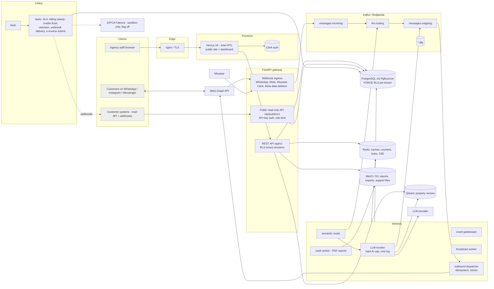

# OmniFlow architecture

Real components only — everything below exists in the repository. Items marked *(flag off)* are built but disabled by default.

## Request path of a customer message
1. Meta POSTs a signed webhook → signature check (HMAC) → tenant resolved from the phone-number / page id → customer + conversation persisted → event published to `messages.incoming`.
2. **Semantic router** classifies (L0 canned / L1 / L2 RAG / L3) and decides human routing; **LLM invoker** reserves one reply atomically (plan quota → top-up credits, Redis Lua) *before* calling the model, composes tenant persona + company profile + RAG context, and publishes to `messages.outgoing`.
3. **Outbound dispatcher** checks idempotency and human-takeover fencing, then calls the Graph API with the tenant's own token (encrypted at rest). Failures retry, then go to `<topic>.dlq`.
4. Hand-off to a human, comment replies *(flag off)*, VCard flow, and broadcasts use the same pipeline with different routing.

## Tenant isolation
Every tenant table has `FORCE ROW LEVEL SECURITY` with `tenant_id = current_setting('app.current_tenant_id')`; the application connects as a non-superuser role (checked at startup in production). System-level tables are readable only in the reserved system context. Tests: `tests/test_tenant_isolation.py` (structural, cross-tenant read/write per table, every id-addressed API route incl. the public API) and `tests/test_security_audit.py` (every route authenticated or on an explicit allow-list).

## Billing and limits
Catalog (plans, top-up packs, add-ons) in the database → `GET /api/v1/public/catalog` feeds the public pricing page. Limits enforced server-side (seats, properties, contacts, channels, campaigns, AI replies). Payments via Moyasar (hosted page; webhook re-fetches the payment). Invoices as PDF; credit notes on refunds. ZATCA module *(flag off)* builds UBL/QR/signature locally; nothing is sent anywhere unless explicitly enabled in sandbox.

## Data lifecycle
Customer erasure = files first, then PII wipe (`privacy.anonymize_customer`); scheduled retention *(off, dry-run)*; Meta data-deletion callback removes page tokens/ids and gives the user a status code.

## What is NOT in the picture
No CDN/WAF config, no multi-region, no autoscaling; monitoring (Prometheus/Grafana/alert rules) is defined in `omniflow-deploy/` but was never run against a live stack.
